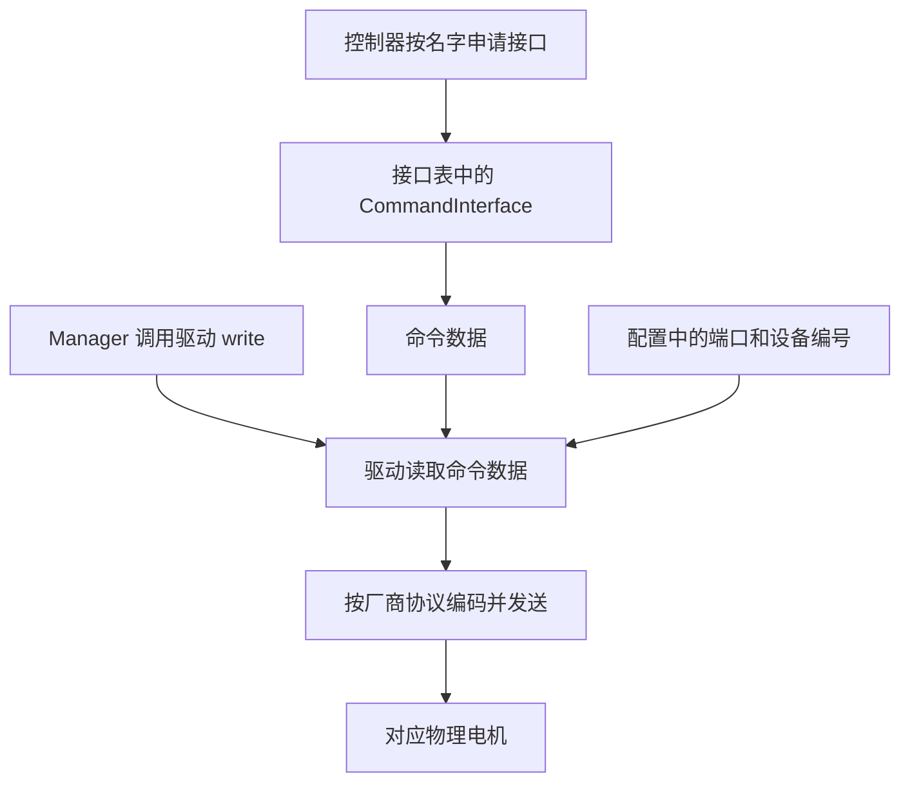

本篇属于 **ROS 2 与机器人控制** 系列，正文第 4 篇。[专题目录](/blog/ros2-series-guide/) · [上一篇](/blog/ros2-controller-manager-and-services/) · [下一篇](/blog/ros2-pluginlib-and-plugin-lifecycle/)

控制器写入 `left_elbow_joint/position = 1.0`，左肘电机为什么会运动？答案分成几层：配置决定关节属于哪个硬件对象；接口关联命令数据；Manager 调用驱动方法；驱动按设备地址和协议发送数据。接口名字本身不会调用驱动，也不包含自动识别物理接线的能力。

本篇沿一台拥有机械臂和夹爪的机器人，把这些对应关系逐项拆开。

## 状态接口与命令接口是什么

| 类别 | 数据代表什么 | 典型访问者 |
| --- | --- | --- |
| 状态接口 | 实际位置、速度、力矩等反馈 | 控制器、状态广播器读取 |
| 命令接口 | 目标位置、速度、力矩等控制输出 | 控制器写入，硬件驱动使用 |

分类取决于数据含义，不取决于动作叫“读”还是“写”。驱动也会读取命令值，但它读取的仍是命令接口。广播器读取实际位置，访问的是状态接口。

驱动可能向电机发送“查询位置”的设备协议指令，再把回复写入状态接口。这个协议中的查询命令不等于 ros2_control 的命令接口。广播器通常不直接执行设备查询。

## 关节怎样归到驱动对象

下面是说明用的 URDF 控制配置片段，`ArmHardware` 是示例驱动名：

```xml
<ros2_control name="LeftArm" type="system">
  <hardware>
    <plugin>robot_driver/ArmHardware</plugin>
    <param name="can_device">can0</param>
  </hardware>
  <joint name="left_shoulder_joint">
    <param name="motor_id">11</param>
    <command_interface name="position"/>
    <state_interface name="position"/>
  </joint>
  <joint name="left_elbow_joint">
    <param name="motor_id">12</param>
    <command_interface name="position"/>
    <state_interface name="position"/>
  </joint>
</ros2_control>
```

解析器将同一个 `<ros2_control>` 块中的插件、参数、关节组织成同一份 `HardwareInfo`，再把它传给对应驱动对象初始化。源码中的关键语句是 `hardware.joints.push_back(...)`，见 [URDF 解析][parser-source]。

因此，框架提供的是这种归属关系：

```text
LeftArm 的 HardwareInfo
  ├─ plugin = robot_driver/ArmHardware
  ├─ hardware_parameters 中有 can_device
  └─ joints 中有 left_shoulder_joint 和 left_elbow_joint
                      ↓
传给这一次创建的 ArmHardware 对象
```

同一驱动类可以创建多个实例，例如左右两条机械臂。各实例收到各自的配置，不会因为类名相同而自动共享所有关节。

## 关节怎样对应物理设备

驱动作者需要解析自定义参数。例如初始化逻辑可以概念化为：

```cpp
for (const auto & joint : params.hardware_info.joints)
{
  Motor motor;
  motor.joint_name = joint.name;
  motor.device_id = std::stoi(joint.parameters.at("motor_id"));
  motors.push_back(motor);
}
```

`motor_id` 和 `can_device` 都是这个示例驱动自行约定的参数。框架传递配置，驱动决定如何解释它们。

| 关节 | 驱动实例 | 通信端口 | 设备编号 |
| --- | --- | --- | --- |
| `left_shoulder_joint` | LeftArm | `can0` | 11 |
| `left_elbow_joint` | LeftArm | `can0` | 12 |
| `gripper_joint` | Gripper | `/dev/ttyUSB0` | 1 |

CAN 帧标识、节点地址和寄存器布局的具体含义由厂商协议决定，不能假设所有电机都使用相同编码。编号、单位换算、方向、减速比和零位也需要按设备配置处理。

## command_interface_map 到底保存什么

Resource Manager 内部的实际类型是：

```cpp
std::map<std::string, CommandInterface::SharedPtr> command_interface_map_;
```

见 [接口容器定义][storage-source]。它是“接口全名 → 命令接口对象的共享指针”，不是 `string → string`，也不是“接口名 → 驱动函数地址”。

一个 Resource Manager 中，多个硬件组件导出的命令接口进入同一张表。完整名称必须唯一，例如：

```text
left_shoulder_joint/position → 接口对象 A
left_elbow_joint/position    → 接口对象 B
gripper_joint/position       → 接口对象 C
```

硬件组件名不会自动加到键前面，所以两块硬件不能仅靠组件名不同，就同时导出完全相同的命令接口全名。状态接口保存在另一张 `state_interface_map_` 中，因此同一个关节可以同时有同名的命令、状态接口。

## 接口对象怎样关联命令数据

这里要分清旧的导出写法与本快照支持的较新写法。

旧写法显式把变量地址交给接口：

```cpp
CommandInterface(
  "left_elbow_joint", "position", &motors[1].target_position
);
```

它建立的是：

```text
接口对象 → 变量地址 → motors[1].target_position
```

通过接口执行 `set_value(1.0)`，就是修改该变量。不是调用 `ArmHardware::write()`。这类指针构造在本快照中已标记为弃用，适合解释机制，不应当作所有新驱动的唯一模板。变量存储必须稳定，导出后重分配底层容器会使指针失效。

较新路径根据 `InterfaceDescription` 创建接口对象，由接口对象管理数据。硬件基类保留访问句柄，同时把同一批共享接口对象交给 Resource Manager。具体创建逻辑见 [on_export_command_interfaces][export-source]。

在这种路径中，驱动可以通过 `get_command(...)` 或预先取得的接口句柄访问命令数据，反馈通过 `set_state(...)` 等方法更新。重要的是双方访问同一份接口数据，并不要求数据一定是驱动自己声明的裸 `double` 成员。

## 控制器如何申请接口

控制器实现两个方法，分别声明所需命令接口和状态接口：

```cpp
InterfaceConfiguration command_interface_configuration() const override;
InterfaceConfiguration state_interface_configuration() const override;
```

返回的 `InterfaceConfiguration` 包含 `type` 和 `names`。例如需要两个关节的位置命令接口：

```cpp
return {
  interface_configuration_type::INDIVIDUAL,
  {"left_shoulder_joint/position", "left_elbow_joint/position"}
};
```

枚举的选项表示选择规则：

| 选项 | Manager 如何确定接口 |
| --- | --- |
| `ALL` | 选取这类所有可用接口 |
| `INDIVIDUAL` | 使用明确列出的名字，不能通过筛选静默忽略缺项 |
| `NONE` | 不需要这类接口 |
| `INDIVIDUAL_BEST_EFFORT` | 只保留所列名字中当前可用的接口 |
| `REGEX` | 用正则表达式匹配可用接口的完整名字 |

`enum class ... : std::uint8_t` 表示底层为 8 位无符号整数的强类型枚举；`0、1、2、3、10` 是编号，没有优先级或频率含义，也不是供按位组合的标志。

`INDIVIDUAL_BEST_EFFORT` 只在选择名称时跳过不可用项，不保证后续资源申请、控制器激活一定成功。命令接口还可能已被占用，控制器也可能要求最低接口数量。不要凭 `ALL` 或正则结果的下标猜关节，应按名字建立所需顺序。

Manager 随后调用 `claim_command_interface(key)`：检查可用性和占用状态，标记已占用，从表里取出接口对象，包装为 `LoanedCommandInterface` 交给控制器。它是进程内资源借用，不是一次电机通信。见 [申请实现][claim-source]。

同一个命令接口通常只能被一个控制器占用；状态接口允许多个消费者共享。Loaned 接口结合释放回调实现资源归还。状态广播器通常返回命令 `NONE`、状态 `ALL` 或所需子集，因为它只读反馈并向 ROS 发布。

## 真正调用驱动的是另一条路径

驱动对象指针保存在硬件包装对象的 `impl_` 中；包装对象放在 `systems_`、`actuators_` 或 `sensors_` 容器中。Manager 经 Resource Manager 遍历硬件对象，调用 `read()`、`write()`。

驱动的写入逻辑概念上是：

```cpp
for (const auto & motor : motors)
{
  const double target = get_command(motor.joint_name + "/position");
  auto packet = vendor_protocol.encode_position(motor.device_id, target);
  bus.send(packet);
}
```

这是教学伪代码。真实驱动一般在初始化阶段准备映射、缓存句柄与通信资源，控制循环中尽量避免字符串拼接和动态分配。

整条链可以画成：



因此有三个不同的“地址”：驱动对象内存地址、接口数据地址、物理设备通信地址。它们由不同对象保存，不能混为一谈。

## 不依赖 ROS 的可运行示例

[配套的 interface_mapping.cpp](/downloads/ros2/interface_mapping.cpp) 实现了一个普通 C++17 教学模型：一张接口表、两个硬件对象、三个关节。它使用旧式指针关联说明内存关系，发送动作只打印，不访问真实设备。

先将[完整学习包](/downloads/ros2-control-learning.zip)解压到 ros2_control 仓库根目录，再执行：

```bash
c++ -std=c++17 -Wall -Wextra -pedantic \
  doc/learning/ros2-series/examples/interface_mapping.cpp \
  -o /tmp/ros2-interface-mapping
/tmp/ros2-interface-mapping
```

预期打印左肩目标 0、左肘目标 1、夹爪目标 0.02，并带有各自端口和设备编号。观察“控制器改内存”与“Manager 调用硬件对象”是分开的两个阶段。程序没有模拟 pluginlib，插件实例化在下一篇解释。

## 复习问题

1. map 的键和值分别是什么？它能否直接找到 CAN 电机？
2. 哪段配置决定两个关节归同一个驱动实例？
3. 物理设备编号由框架理解还是驱动理解？
4. `set_value()` 之后为什么真实电机还可能没收到消息？
5. 较新接口管理方式为何不一定指向驱动自建的裸变量？

过关标准是从一个关节目标出发，逐一指出名字解析、数据访问、虚函数调用和设备通信各发生在哪里。

## 源码入口

- [URDF 解析][parser-source]。
- [资源与接口容器][storage-source]。
- [接口选择枚举][enum-source]。
- [较新接口导出方式][export-source]。
- [命令接口申请][claim-source]。
- [硬件包装对象][component-source]。

[parser-source]: https://github.com/ros-controls/ros2_control/blob/fd5744d6bb9b2b0fae010be411dbfb7ca65228ff/hardware_interface/src/component_parser.cpp#L697
[storage-source]: https://github.com/ros-controls/ros2_control/blob/fd5744d6bb9b2b0fae010be411dbfb7ca65228ff/hardware_interface/src/resource_manager.cpp#L1368
[enum-source]: https://github.com/ros-controls/ros2_control/blob/fd5744d6bb9b2b0fae010be411dbfb7ca65228ff/controller_interface/include/controller_interface/controller_interface_base.hpp#L59
[export-source]: https://github.com/ros-controls/ros2_control/blob/fd5744d6bb9b2b0fae010be411dbfb7ca65228ff/hardware_interface/src/hardware_component_interface.cpp#L267
[claim-source]: https://github.com/ros-controls/ros2_control/blob/fd5744d6bb9b2b0fae010be411dbfb7ca65228ff/hardware_interface/src/resource_manager.cpp#L1883
[component-source]: https://github.com/ros-controls/ros2_control/blob/fd5744d6bb9b2b0fae010be411dbfb7ca65228ff/hardware_interface/include/hardware_interface/hardware_component.hpp
