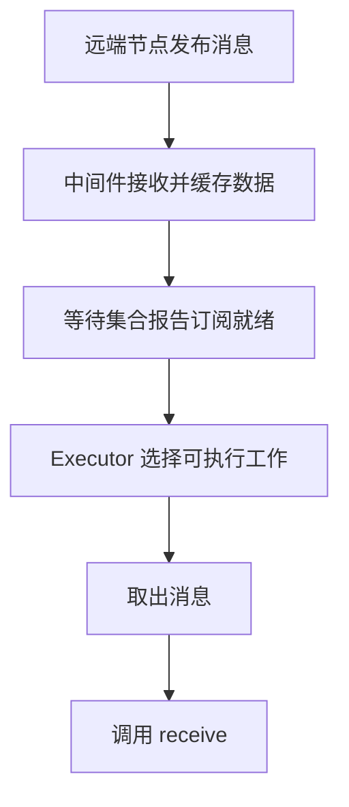

本篇属于 **ROS 2 与机器人控制** 系列，正文第 2 篇。[专题目录](/blog/ros2-series-guide/) · [上一篇](/blog/ros2-robot-startup-and-architecture/) · [下一篇](/blog/ros2-controller-manager-and-services/)

创建 Node、启动进程和调用 `spin()` 是三个不同动作。Node 建立通信实体；Executor 等待并执行回调；操作系统线程承载这些代码的执行。把这三层分开，才能理解消息已经到达但回调没有运行、异步请求一直未完成，以及主线程为什么停在 `spin()`。

## Node 在哪里创建

下面的程序由 `python3 script.py` 启动为一个进程：

```python
import rclpy
from rclpy.node import Node

rclpy.init()
node = Node("rrbot_motion_check")
rclpy.spin(node)
```

`rclpy.init()` 初始化 ROS 上下文，`Node(...)` 创建节点。执行到 `spin()` 前，节点对象已经存在，Publisher、Subscription、Client 等实体也可以创建。

所以 `spin()` 的作用是持续处理工作，不是创建节点。一般也不是其他节点调用这个节点的 `spin()`。

## Executor 如何让回调运行

例如注册订阅：

```python
def receive(message):
    print(message.position)

subscription = node.create_subscription(
    JointState, "/joint_states", receive, 10
)
```

这里仅登记了消息到来后的处理方式。Executor 将订阅、定时器、服务端、客户端响应等实体纳入等待集合，等待其中的工作就绪；随后根据回调组规则选择工作，取出数据并执行处理函数。等待集合记录的是实体的就绪情况，不是全部消息组成的一条应用层队列。见 [Executor 概念说明][executor-doc]。



中间件可以在应用回调不运行时接收和缓存数据；队列满后如何保留或丢弃，受 QoS 等条件影响。若没有任何 Executor 处理该节点，常规订阅回调就不会自动执行。直接调用 `publisher.publish(...)` 则不要求先进入 `spin()`。

## 三种 spin 的区别

| 调用 | 什么时候返回 | 在检查脚本里的用途 |
| --- | --- | --- |
| `rclpy.spin(node)` | 持续执行工作，直到上下文等退出条件生效 | 长时间运行的节点 |
| `rclpy.spin_once(node, timeout_sec=0.1)` | 执行一次工作，或等待就绪超时等 | 穿插处理回调并检查应用条件 |
| `rclpy.spin_until_future_complete(node, future, timeout_sec=2)` | 指定 Future 完成、等待超时或上下文退出等 | 等待服务响应，同时处理节点工作 |

这些是便捷函数，内部会使用 Executor。对应实现可从 [rclpy 的入口函数][rclpy-init] 和 [Executor 实现][rclpy-executor] 对照阅读。

`spin_once` 不是固定睡眠。消息立即可用时，它可能很快返回；`0.1` 表示等待工作的超时设置，不表示控制器以 10 Hz 运行。已开始执行的普通回调也不会因达到 `0.1` 秒而被强制中断。

`spin_until_future_complete` 不只处理指定响应，等待期间也可能执行订阅等其他工作。超时返回不等于服务已取消，调用方仍应检查 `future.done()`、结果和异常。

## 服务客户端和 Future

检查脚本创建客户端：

```python
client = node.create_client(
    ListControllers,
    "/controller_manager/list_controllers"
)
```

它表示“这个节点准备调用该类型的服务”，此时没有发送请求。接下来才是：

```python
future = client.call_async(ListControllers.Request())
rclpy.spin_until_future_complete(node, future, timeout_sec=2)

if future.done() and future.exception() is None:
    response = future.result()
```

Future 是将来结果的占位对象。客户端发送请求，中间件收到响应后，Executor 处理响应并让相应 Future 获得结果。`wait_for_service()` 检查服务发现情况；它不代表某个控制器已经激活。

因此，客户端是通信入口，Future 表示某次调用，Executor 推动响应处理，这三者各有职责。

## 在另一个线程 spin 是什么意思

可以让同一进程的后台线程执行 Executor，主线程继续做其他工作。下面是一个可单独运行的 Python 例子：

```python
import threading
import time

import rclpy
from rclpy.executors import SingleThreadedExecutor
from rclpy.node import Node

rclpy.init()
node = Node("background_executor_demo")
timer = node.create_timer(0.5, lambda: node.get_logger().info("timer callback"))
executor = SingleThreadedExecutor()
executor.add_node(node)
worker = threading.Thread(target=executor.spin)
worker.start()

try:
    time.sleep(2.0)  # 主线程的普通工作
finally:
    executor.shutdown()
    worker.join()
    node.destroy_node()
    rclpy.shutdown()
```

这里是另一个线程执行本地函数，并没有向其他 ROS 节点暴露一个远程 `spin` 接口。不要同时在主线程对同一节点调用便捷 `spin`，让两个执行路径争用它。共享数据也需要明确的同步方式。

## 多线程 Executor 不等于所有回调都并行

SingleThreadedExecutor 在调用线程中串行执行回调；MultiThreadedExecutor 可以使用多个工作线程。不过，回调组仍会限制并发。

| 回调组 | 允许的行为 |
| --- | --- |
| `MutuallyExclusiveCallbackGroup` | 同组回调不能同时执行 |
| `ReentrantCallbackGroup` | 允许并发，包括相同回调的并发执行 |

默认回调组通常为互斥组。即使 Executor 有多个线程，把工作全部放进同一个互斥组，也不会让这些工作自动并行。使用可重入组前，需要保证回调自己的数据访问支持并发。见 [rclpy 回调组实现][callback-groups]。

另一个常见问题是在回调中阻塞等待服务，而服务响应处理又受同一互斥组限制。此时增加线程数量也未必解决问题，应调整异步处理或回调组安排。

## C++ 的 spin 后面还能执行吗

仓库主程序里有：

```cpp
executor->spin();
cm_thread.join();
rclcpp::shutdown();
```

正常运行时，主线程停留在 `spin()` 中处理事件。它返回后，才执行 `join()` 和后面的代码。

默认信号处理配置下，Ctrl+C 会从另一条执行路径触发 ROS 上下文关闭：Executor 结束等待，控制线程里的 `rclcpp::ok()` 变为 false，控制线程退出，主线程通过 `join()` 等待它结束。所以不需要先执行最后一行 `shutdown()`，前面的 `spin()` 才有机会退出。

`executor->cancel()` 只取消该 Executor 的持续 spin，不自动让控制线程的 `rclcpp::ok()` 变为 false。因此只 cancel 后，程序仍可能阻塞在 `cm_thread.join()`。正在运行的普通长回调也不会被 cancel 强制打断。

## Manager 中其实有两条执行路径

[ros2_control_node 的主函数][main-source] 单独创建了 `cm_thread`：

```text
Executor 路径                       控制循环路径
等待 ROS 工作                      while rclcpp::ok
  ↓                                  ↓
订阅和服务回调                     read → update → write
```

控制器节点加入 Executor，是为了处理其 ROS 回调。控制器的周期性 `update()` 由控制循环调度，不是因为它加入 Executor 就自动执行。

这两条路径通过缓冲区、锁或其他同步机制交换信息。例如 ROS 回调接收目标，控制循环在合适的周期读取目标。消息到达时刻和命令实际生效时刻不必相同。

## 复习问题

1. 创建了 Node 却没有 Executor 处理它，哪些代码还可以执行？
2. 为什么 `spin_once(..., 0.1)` 不代表固定 10 Hz？
3. 为什么服务超时后 Future 可能仍未完成？
4. 为什么 `cancel()` 以后还可能卡在 `join()`？
5. ROS 回调执行频率、Manager 频率、控制器更新频率有什么区别？

过关标准是能指出每段代码由哪一个线程执行，并解释消息接收、回调运行和控制输出之间的时间关系。

## 源码入口

- [Executor 概念说明][executor-doc]：等待集合与执行模型。
- [rclpy spin 便捷函数][rclpy-init]：Node 如何交给 Executor。
- [rclpy Executor][rclpy-executor]：工作选择、服务响应与线程调度。
- [rclpy Callback Groups][callback-groups]：并发规则。
- [本仓库主程序][main-source]：Executor 与控制线程的关系。

[executor-doc]: https://github.com/ros2/ros2_documentation/blob/jazzy/source/Concepts/Intermediate/About-Executors.rst
[rclpy-init]: https://github.com/ros2/rclpy/blob/jazzy/rclpy/rclpy/__init__.py
[rclpy-executor]: https://github.com/ros2/rclpy/blob/jazzy/rclpy/rclpy/executors.py
[callback-groups]: https://github.com/ros2/rclpy/blob/jazzy/rclpy/rclpy/callback_groups.py
[main-source]: https://github.com/ros-controls/ros2_control/blob/fd5744d6bb9b2b0fae010be411dbfb7ca65228ff/controller_manager/src/ros2_control_node.cpp
