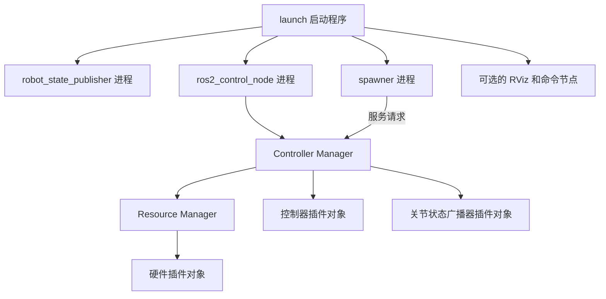
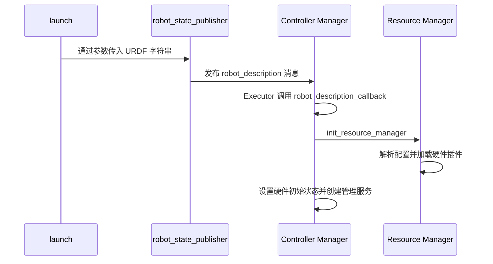

本篇属于 **ROS 2 与机器人控制** 系列，正文第 1 篇。[专题目录](/blog/ros2-series-guide/) · [上一篇](/blog/ros2-series-guide/) · [下一篇](/blog/ros2-node-executor-and-spin/)

一台机器人启动时，launch、节点、控制器、驱动插件和硬件设备会一起出现。理解它们的关键，是分清两件事：谁作为程序独立运行，谁作为对象加载在程序内部；谁传递消息，谁实际执行控制。

本篇以 ROS 2 Jazzy 和 RRBot Example 1 为例，建立后续阅读 ros2_control 源码所需的整体结构。Manager 和 Controller Manager 在这里指同一个组件。

## 进程 节点 线程与插件

进程是操作系统运行程序的单位；线程是进程内部的执行路径；ROS 节点是组织通信接口与功能的逻辑单位；插件是被宿主程序加载的代码和对象。这四者不能互相等同。

| 概念 | 例子 | 需要记住的关系 |
| --- | --- | --- |
| 进程 | `ros2_control_node` 可执行程序启动后的进程 | 可以包含多个节点和线程 |
| 节点 | `/controller_manager`、位置控制器的节点 | 不必各占一个进程 |
| 线程 | Executor 工作线程、控制循环线程 | 同一进程中的线程共享地址空间 |
| 插件对象 | 硬件驱动对象、控制器对象 | 通常加载到宿主进程内 |
| 物理设备 | CAN 电机、串口夹爪 | 通过驱动实现通信 |

因此，`ros2 node list` 中出现多个名称，不代表系统启动了同样数量的独立程序。控制器可以有自己的 LifecycleNode，同时与 Manager 处于一个进程。

## RRBot 启动时有哪些组件

典型结构如下，具体进程布局也可以通过组件组合方式调整：



`launch` 负责按配置启动和监控程序。`spawner` 通过 Manager 的服务加载、配置、激活控制器，完成任务后通常退出。它们都不负责每个周期计算电机命令。

`ros2_control_node` 中的 Manager 管理控制器和控制循环；Resource Manager 管理硬件组件、接口及资源占用。硬件插件与设备通信，控制器使用接口中的数据。

无界面版本省掉 RViz，控制链本身仍然存在。

## URDF 为什么会进入控制系统

URDF 不仅描述连杆、关节和外观，还可以通过 `<ros2_control>` 描述硬件配置：

```xml
<ros2_control name="LeftArm" type="system">
  <hardware>
    <plugin>robot_driver/ArmHardware</plugin>
  </hardware>

  <joint name="left_elbow_joint">
    <command_interface name="position"/>
    <state_interface name="position"/>
  </joint>
</ros2_control>
```

这是 XML 配置片段。`ArmHardware` 是说明用的插件名，不是本仓库现成的驱动。

| 内容 | 表示什么 |
| --- | --- |
| `name="LeftArm"` | 硬件组件的实例名称，用于识别与生命周期管理 |
| `type="system"` | 系统级硬件组件，插件应匹配 `SystemInterface` |
| `<plugin>` | 加载哪个硬件驱动类 |
| `<joint>` | 该组件负责哪些关节及其接口 |

另外还有 `actuator` 和 `sensor` 类型，分别对应 `ActuatorInterface`、`SensorInterface`。硬件组件名既不是控制器名，也不自动成为 ROS 节点名。

URDF 中的硬件配置回答“设备提供什么”；控制器 YAML 回答“加载什么控制器、使用哪些关节和参数”。

## 机器人描述如何到达 Manager

在本文的启动方式中，launch 执行 xacro 生成 URDF 字符串，并把它作为 `robot_description` 参数传给 `robot_state_publisher`。后者发布 `robot_description` 话题，Manager 订阅该话题。



参数和话题虽然同名，职责不同：参数是节点保存的配置，话题是跨节点传递数据的通道。Manager 收到的是 URDF 的文本内容，而不是要求它去读取的文件路径。

`robot_description_callback()` 由收到消息触发，不按控制频率执行。创建订阅只登记处理方式；消息到达并由 Executor 处理时，回调才运行。资源已经初始化后，再收到描述消息不会重新加载硬件。见 [Manager 的机器人描述处理流程][description-source]。

Manager 的订阅使用 `transient_local`。在发布方也保留相应历史数据、端点仍存在且 QoS 兼容的情况下，晚启动的订阅者可以获得之前的描述。它不是永久的消息存储服务。

## robot_state_publisher 为什么可以独立运行

`robot_state_publisher` 不由 Controller Manager 调度。它读取机器人模型、发布描述，并把收到的关节位置转换为坐标变换，发布 `/tf`；固定关节的变换通过 `/tf_static` 发布。相应行为见 [Jazzy 的实现][rsp-source]。

它只需要有人提供关节状态，不要求发送者必须是 ros2_control。启动描述和接收状态是两个不同阶段，因此不存在“必须先有 Manager 的状态，才能发布 URDF”的启动死循环。

在 RRBot 中，关节状态由 `joint_state_broadcaster` 提供：

```text
硬件 read 更新状态接口
        ↓
joint_state_broadcaster 读取状态接口
        ↓ 发布 /joint_states
robot_state_publisher 计算坐标变换
        ↓ 发布 /tf
RViz 或其他消费者
```

广播器发布的是状态消息，不是广播查询请求。它需要状态接口和 ROS Publisher，不需要向电机下发目标的命令接口。

## 启动后的控制与反馈

正常同步控制路径是：

```text
命令节点发布目标
    ↓
控制器的订阅回调接收目标
    ↓
控制器 update 读取状态并写命令接口
    ↓
硬件 write 把命令发给设备
    ↓
设备产生反馈
    ↓
硬件 read 更新状态接口
    ↓
控制器和广播器读取状态
```

这是一条持续运行的链。Controller Manager 组织调用，控制器决定控制输出，硬件插件实现设备协议。通用框架不会仅凭 `joint1` 这样的名字识别实际电机。

## 亲自观察

在已有 RRBot 容器的 ROS 终端执行：

```bash
ros2 node list
ros2 topic info /robot_description --verbose
ros2 topic echo /robot_description --qos-durability transient_local --once
ros2 control list_controllers
ros2 control list_hardware_components
```

观察话题发布者、订阅者、控制器状态，以及硬件组件的名称与插件名。`list_hardware_components` 中的 `RRBot` 是组件实例名，后面的插件类型是另一种名称。

## 复习问题

1. 为什么一个进程里可以出现多个 ROS 节点？
2. 参数 `robot_description` 和同名话题分别负责什么？
3. 没有 Manager 时，谁可以为 `robot_state_publisher` 提供关节状态？
4. 关节状态广播器、控制器、硬件插件分别写入或读取哪类数据？

过关标准是能画出启动关系与控制数据流，并指出每个箭头是参数传入、ROS 消息，还是进程内调用。

## 源码入口

本文的 ros2_control 源码基线为本机 Jazzy 分支快照 `fd5744d6bb9b2b0fae010be411dbfb7ca65228ff`。发行版安装包与该快照的细节可能不同。

- [ros2_control_node 主函数][main-source]：观察进程内的 Executor 与控制线程。
- [robot_description 的订阅与初始化][description-source]：观察消息如何变成硬件配置。
- [robot_state_publisher 的 Jazzy 实现][rsp-source]：观察描述与 TF 的发布。

[main-source]: https://github.com/ros-controls/ros2_control/blob/fd5744d6bb9b2b0fae010be411dbfb7ca65228ff/controller_manager/src/ros2_control_node.cpp
[description-source]: https://github.com/ros-controls/ros2_control/blob/fd5744d6bb9b2b0fae010be411dbfb7ca65228ff/controller_manager/src/controller_manager.cpp#L753
[rsp-source]: https://github.com/ros/robot_state_publisher/blob/jazzy/src/robot_state_publisher.cpp
